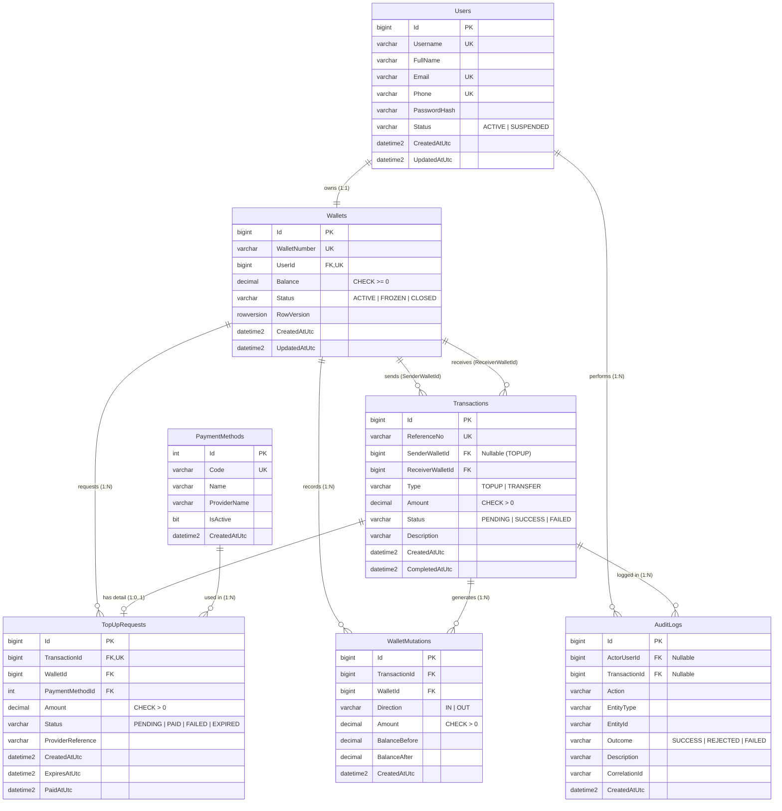

# E-Wallet System (.NET / ASP.NET Core & EF Core)

Aplikasi manajemen dompet digital (_E-Wallet_) berbasis ASP.NET Core dan Entity Framework Core dengan SQL Server. Sistem ini mendukung registrasi pengguna, pengelolaan dompet beserta proteksi _optimistic concurrency_ (`RowVersion`), _top-up_ melalui berbagai metode pembayaran, transfer antar-pengguna, pencatatan mutasi saldo (`IN`/`OUT`), serta _audit logging_.

## Perbedaan Transactions, WalletMutations, dan AuditLogs

- **Transactions**: Menyimpan niat dan status dari sebuah peristiwa finansial (misal: Top up / Transfer), siapa yg mengirim / menerima, nominalnya, dan status transaksi (PENDING, SUCCESS, FAILED). 1 kali transfer menghasilkan 1 baris transaksi.

- **Wallet Mutation**: Mencatat dampak riil perubahan uang pada saldo setiap wallet secara jelas (IN / OUT), lengkap dg BalanceBefore dan BalanceAfter. Hanya dibuat jika transaksi SUCCESS. 1 kali transfer sukses menghasilkan 2 baris mutasi (OUT di pengirim, IN di penerima) untuk menjamin akurasi audit keuangan (_reconciliation_).

- **AuditLogs**: Mencatat seluruh kejadian teknis maupun percobaan aksi di sistem, termasuk aksi non-finansial (misal ubah status wallet) maupun percobaan transaksi yg ditolak (REJECTED) atau gagal (FAILED), lengkap siap aktornya (ActorUserId) dan CorrelationId untuk kebutuhan debugging dan keamanan.

## Alasan Penggunaan `AsNoTracking`, Database Transaction dan `RowVersion`

- `AsNoTracking()` digunakan pada query yg hanya membaca data (misal menampilkan data transaksi, riwayat mutasi, atau detail profil), dimana endpoint tersebut tidak membutuhkan pengubahan data (CUD), sehingga penggunaan memory jauh lebih hemat dan eksekusi query lebih cepat.

- Database Transaction (`BeginTransactionAsync`) digunakan ketika transaksi melibatkan banyak langkah sekaligus. Misal transfer, melibatkan pengurangan saldo, menambah saldo, mengubah status transaksi, membuat 2 mutasi saldo, dan mencatat log. Dg membungkusnya dalam database transaction, semua proses bersifat _all-or-nothing_, jika satu langkah gagal, seluruh perubahan di-_rollback_ sehingga tidak akan pernah terjadi kasus saldo pengirim terpotong tetapi saldo penerima tidak bertambah.

- `RowVersion` berfungsi sbg penanda versi baris data di table Wallets yg otomatis berubah setiap kali baris tersebut di-update oleh SQL Server. Jika 2 transaksi mencoba memotong saldo wallet di waktu yg sama, transaksi pertama berhasil memperbarui `RowVersion`, sementara transaksi kedua akan otomatis digagalkan oleh EF Core(DbUpdateCurrencyException) karena RowVersion yang dibawa sudah usang/kadaluarsa, sehingga saldo tidak akan pernah minus / salah hitung.

## Technologies

- **Framework:** .NET 10 / ASP.NET Core (Web API)
- **ORM:** Entity Framework Core (Code-First)
- **Database:** Microsoft SQL Server
- **Error Handling:** Global Exception Handler
- **Scalar** OpenAPI

## Getting Started

### Prasyarat

- [.NET SDK](https://dotnet.microsoft.com/download) (versi 10.0)
- [SQL Server](https://www.microsoft.com/sql-server)
- EF Core CLI Tools:
  ```bash
  dotnet tool install --global dotnet-ef
  ```

## Cara Menjalankan Aplikasi

1. **Clone repository & masuk ke direktori proyek:**

   ```bash
   git clone https://github.com/bando9/koda-b1-weekly6
   cd koda-b1-weekly6
   ```

2. **Konfigurasi Connection String:**
   Buka file `appsettings.json` (atau `appsettings.Development.json`) dan sesuaikan `DefaultConnection` dengan kredensial SQL Server lokalmu:

   ```json
   {
     "ConnectionStrings": {
       "DefaultConnection": "Server=localhost;Database=EwalletDb;Trusted_Connection=True;TrustServerCertificate=True;"
     }
   }
   ```

3. **Restore dependencies & jalankan aplikasi:**
   ```bash
   dotnet restore
   dotnet run
   ```
   Aplikasi akan berjalan pada alamat yang tertera di terminal (misalnya `http://localhost:5000`).

## Database Migration

Skema database dikelola menggunakan EF Core Code-First Migrations dengan _check constraints_, _unique indexes_, dan konfigurasi relasi di `AppDbContext`.

- **Membuat migration baru** (jika ada perubahan pada model):

  ```bash
  dotnet ef migrations add <NamaMigration>
  ```

- **Menerapkan migration ke database:**

  ```bash
  dotnet ef database update
  ```

- **Reset ulang database dari awal**
  _(opsional, untuk membersihkan data dummy)_:
  ```bash
  dotnet ef database drop -f
  dotnet ef database update
  ```

## Data Seeding

Aplikasi menerapkan **Idempotent Runtime Seeding** melalui `UseSeeding` dan `UseAsyncSeeding` pada konfigurasi `AppDbContext` di `Program.cs`. Data awal akan otomatis diisi saat perintah `dotnet ef database update` dijalankan atau saat aplikasi melakukan migrasi saat _startup_.

### Cakupan Data Seeding:

1. **`PaymentMethodSeedData`:** 4 metode pembayaran aktif (`VA_BCA`, `VA_MANDIRI`, `QRIS`, `RETAIL_ALFA`).
2. **`UserWalletSeedData`:** 10 pengguna aktif (`andi.pratama` hingga `joko.susilo`) beserta 10 wallet dengan saldo awal **Rp0**.
3. **`TransactionSeedData`:** Simulasi transaksi _top-up_ dan transfer (dengan status `SUCCESS`, `PENDING`, dan `FAILED`), pembuatan `TopUpRequest`, mutasi saldo (`WalletMutation`), pencatatan `AuditLog`, serta penyesuaian saldo akhir wallet secara otomatis.

### Ringkasan Saldo Akhir Hasil Seeding:

| Username        | No. Wallet |   Top-Up Sukses | Transfer Keluar | Transfer Masuk |   Saldo Akhir |
| :-------------- | :--------- | --------------: | --------------: | -------------: | ------------: |
| `andi.pratama`  | `W-0001`   |       Rp500.000 |      -Rp150.000 |            Rp0 | **Rp350.000** |
| `budi.santoso`  | `W-0002`   |       Rp300.000 |      -Rp100.000 |            Rp0 | **Rp200.000** |
| `citra.lestari` | `W-0003`   |     Rp1.000.000 |      -Rp400.000 |            Rp0 | **Rp600.000** |
| `dimas.wijaya`  | `W-0004`   | Rp0 _(Pending)_ |             Rp0 |     +Rp150.000 | **Rp150.000** |
| `eka.putri`     | `W-0005`   |  Rp0 _(Failed)_ |             Rp0 |     +Rp400.000 | **Rp400.000** |
| `fajar.nugroho` | `W-0006`   |             Rp0 |             Rp0 |     +Rp100.000 | **Rp100.000** |
| `gita.permata`  | `W-0007`   |             Rp0 |             Rp0 | Rp0 _(Failed)_ |       **Rp0** |
| `hendra.kusuma` | `W-0008`   |             Rp0 |             Rp0 |            Rp0 |       **Rp0** |
| `indah.sari`    | `W-0009`   |             Rp0 |             Rp0 |            Rp0 |       **Rp0** |
| `joko.susilo`   | `W-0010`   |             Rp0 |             Rp0 |            Rp0 |       **Rp0** |

## API Endpoints

Base URL: `/api/v1`

| Endpoint Path                            | HTTP Method | Description                         | Available |
| ---------------------------------------- | ----------- | ----------------------------------- | --------- |
| `/api/v1/users`                          | GET         | Get all users                       | ✅        |
| `/api/v1/users/{id}`                     | GET         | Get user+wallet detail by user ID   | ✅        |
| `/api/v1/users`                          | POST        | Create user and initialize wallet   | ✅        |
| `/api/v1/users/{id}`                     | PUT         | Update user profile                 |           |
| `/api/v1/users/{id}`                     | DELETE      | Delete user by ID                   |           |
| `/api/v1/topup/`                         | POST        | Top up wallet by wallet ID (body)   | ✅        |
| `/api/v1/topup/{topuprequestId}/confirm` | POST        | Confirm top up by top up request ID | ✅        |
| `/api/v1/transfers`                      | POST        | Transfer balance to another wallet  | ✅        |
| `/api/v1/users/{userId}/transactions`    | GET         | Get user transaction history        | ✅        |

## Entity Relationship Diagram (ERD)

Diagram berikut menggambarkan relasi antar-entitas sesuai konfigurasi di `AppDbContext`:


