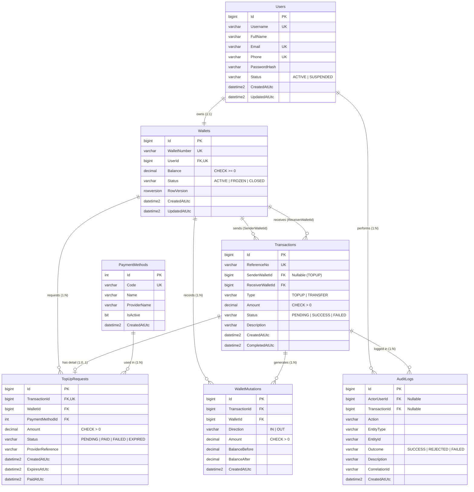

# E-Wallet System (.NET / ASP.NET Core & EF Core)

Aplikasi dompet digital (_E-Wallet_) berbasis **ASP.NET Core** (Backend REST API) dan **React + TypeScript** (Frontend SPA) yang mendukung manajemen saldo, Top Up, Transfer antar pengguna, riwayat mutasi, Role-Based Access Control (RBAC), serta moderasi pengguna oleh Admin dengan pencatatan _Audit Log_.

## Technologies

- **Backend:**
  - .NET 10 / ASP.NET Core Web API & MVC
  - Entity Framework Core
  - ASP.NET Core Identity
  - SQL Server
  - JWT Bearer Authentication
  - Scalar OpenAPI.
- **Frontend:**
  - React
  - TypeScript
  - Vite
  - Tailwind CSS
  - shadcn/ui
  - Base UI
  - React Router.

## Instalasi & Menjalankan Proyek

### 1. Prasyarat

- [.NET SDK 10.0+](https://dotnet.microsoft.com/download)
- [Node.js 20+](https://nodejs.org/)
- SQL Server (LocalDB / SQL Server Express / Docker)

### 2. Menjalankan Backend (`Ewallet.Mvc`)

1. Masuk ke direktori backend:
   ```bash
   cd Ewallet.Mvc
   ```
2. Pulihkan (_restore_) seluruh NuGet package/dependency:
   ```bash
   dotnet restore
   ```
3. Sesuaikan _connection string_ SQL Server dan konfigurasi JWT di `appsettings.json` atau `appsettings.Development.json`:
   ```json
   {
     "ConnectionStrings": {
       "DefaultConnection": "Server=localhost;Database=KodaWalletDb;Trusted_Connection=True;TrustServerCertificate=True;"
     },
     "Jwt": {
       "Issuer": "KodaWallet",
       "Audience": "KodaWalletClient",
       "Key": "GANTI_DENGAN_SECRET_KEY_MINIMAL_32_KARAKTER"
     }
   }
   ```
4. Jalankan server backend:
   ```bash
   dotnet run
   ```
   Backend akan berjalan pada `http://localhost:5138` dan dokumentasi API interaktif dapat diakses di `http://localhost:5138/scalar/`.

### 3. Menjalankan Frontend (React)

1. Masuk ke direktori frontend:
   ```bash
   cd frontend
   ```
2. Install seluruh dependency/package:
   ```bash
   npm install
   # atau jika menggunakan bun:
   # bun install
   ```
3. Pastikan file `.env` mengarah ke URL backend:
   ```env
   VITE_API_BASE_URL=http://localhost:5138/api/v1
   ```
4. Jalankan server pengembangan React:
   ```bash
   npm run dev
   # atau:
   # bun run dev
   ```
   Aplikasi frontend dapat diakses melalui browser di `http://localhost:5173`.

## Database Migration & Seeding

### 1. Membuat & Menerapkan EF Core Migration

Pastikan `dotnet-ef` CLI sudah terpasang (`dotnet tool install --global dotnet-ef`), lalu jalankan perintah berikut dari root solution:

```bash
# Membuat migration baru
dotnet ef migrations add InitialIdentityMigration --project Ewallet.Infrastructure --startup-project Ewallet.Mvc

# Menerapkan seluruh migration ke SQL Server
dotnet ef database update --project Ewallet.Infrastructure --startup-project Ewallet.Mvc
```

### 2. Data Seeding

Saat aplikasi dijalankan ('dotnet run'), seeder otomatis membuat data awal :

- **Roles:** `CUSTOMER` dan `ADMIN` pada tabel `AspNetRoles`.
- **Akun Admin Default:** Akun dengan role `ADMIN` untuk mengakses dashboard administrasi.
- **Payment Methods:** Metode pembayaran simulasi (`VA_BCA`, `VA_MANDIRI`, `QRIS`, `RETAIL_ALFA`) pada tabel `PaymentMethods`.

## Perubahan Arsitektur Tabel (`Users` ke `AspNetUsers`)

- Saat pertama sistem menggunakan table `Users` custom dg mengelola password manual, blm ada hashing, jadi perlu hashing manual menambahkan package tambahan.
- Setelah menggunakan **ASP.NET Core Identity** dg entitas `AppUser: IdentityUser<long>`, tabel pengguna berubah menjadi `AspNetUsers` beserta table bawaan yg otomatis dibuat:
  - `dbo.AspNetRoleClaims`
  - dbo.AspNetRoles
  - dbo.AspNetUserClaims;
  - dbo.AspNetUserLogins;
  - dbo.AspNetUserRoles;
  - dbo.AspNetUsers;
  - dbo.AspNetUserTokens;

- **Keamanan Password Terstandar:** Password tidak lagi di-hash secara manual, melainkan dikelola oleh `PasswordHasher<AppUser>` bawaan Identity (PBKDF2 dengan _salt_ unik per pengguna).
- **Manajemen Role & Policy Terintegrasi:** Relasi pengguna ke role (`CUSTOMER` dan `ADMIN`) tersimpan terstruktur di `AspNetUserRoles` dan terhubung langsung dengan klaim JWT serta `AuthorizationPolicy`.
- **Kustomisasi Properti Bisnis:** Entitas `AppUser` tetap mempertahankan atribut domain E-Wallet seperti `FullName`, `Status` (`ACTIVE` / `SUSPENDED`), `CreatedAtUtc`, dan relasi `1-to-1` ke tabel `Wallets` (`UserId` merujuk ke `AspNetUsers.Id`).

## Hak Akses & Authorization Policy (`CUSTOMER` vs `ADMIN`)

Pembatasan akses diterapkan menggunakan **Role-Based Authorization** dan **Authorization Policy** (`AppPolicies`) pada ASP.NET Core:

| Policy Name                   | Role yang Diizinkan | Cakupan Fitur & Hak Akses                                                                                                                                                              |
| :---------------------------- | :------------------ | :------------------------------------------------------------------------------------------------------------------------------------------------------------------------------------- |
| **`CanAccessCustomerWallet`** | `CUSTOMER`          | Melihat informasi wallet, nomor dompet, saldo, dan riwayat mutasi transaksi milik sendiri.                                                                                             |
| **`CanPerformTransactions`**  | `CUSTOMER`          | Membuat permintaan Top Up, mengonfirmasi pembayaran Top Up, serta melakukan Transfer saldo ke sesama `CUSTOMER`.                                                                       |
| **`CanManageUsers`**          | `ADMIN`             | Melihat ringkasan statistik pengguna, mencari/memfilter daftar pengguna, melihat detail akun pengguna, dan mengubah status akun (`ACTIVE` / `SUSPENDED`) yang tercatat di `AuditLogs`. |
| **`[Authorize]` (Umum)**      | `CUSTOMER`, `ADMIN` | Mengakses dan memperbarui informasi profil pribadi serta mengganti kata sandi akun sendiri.                                                                                            |

Notes:

- Role `ADMIN` tidak memiliki akses ke policy `CanPerformTransactions` maupun `CanAccessCustomerWallet`, sehingga Admin dilarang memindahkan saldo milik `CUSTOMER` secara bebas.

## Cara Pengujian

### 1. Pengujian Alur `CUSTOMER`

1. Buka `http://localhost:5173/register` dan daftarkan dua akun customer baru (misalnya **User A** dan **User B**).
2. Login sebagai **User A**, buka menu **Isi Saldo (Top Up)**, pilih metode pembayaran (misal _Mandiri Virtual Account_ atau _QRIS_), lalu lanjutkan ke halaman konfirmasi dan klik **Simulasikan pembayaran**.
3. Pastikan saldo **User A** bertambah di halaman **Beranda (Dashboard)** dan tercatat di halaman **Aktivitas**.
4. Buka menu **Transfer**, masukkan nomor dompet **User B** dan nominal transfer, lalu konfirmasi. Pastikan saldo **User A** berkurang, saldo **User B** bertambah, dan kedua mutasi tercatat.
5. Coba akses URL `/admin` menggunakan akun **User A** $\rightarrow$ sistem harus menolak akses (`403 Forbidden` / diarahkan keluar dari area admin).

### 2. Pengujian Alur `ADMIN`

1. Login menggunakan akun dengan role **`ADMIN`**.
2. Akses `/admin` untuk melihat statistik pengguna dan daftar pendaftar terbaru.
3. Buka menu **Pengguna** (`/admin/users`), uji fitur pencarian nama/email dan filter status (`Aktif` / `Ditangguhkan`).
4. Klik **Detail** pada akun **User A**, ubah statusnya menjadi **Ditangguhkan (`SUSPENDED`)**, lalu periksa tabel `AuditLogs` di database untuk memastikan log `ADMIN_USER_STATUS_UPDATED` tercatat.
5. Coba akses endpoint `POST /api/v1/transfers` melalui Scalar/Postman menggunakan token `ADMIN` $\rightarrow$ server harus mengembalikan status **`403 Forbidden`**.

## Daftar Endpoint API

Base URL: `http://localhost:5138/api/v1`

### 1. Authentication (`/auth`)

| Method | Endpoint         | Akses         | Deskripsi                                                                      |
| :----- | :--------------- | :------------ | :----------------------------------------------------------------------------- |
| `POST` | `/auth/register` | Public        | Registrasi akun `CUSTOMER` baru beserta pembuatan `Wallet` otomatis.           |
| `POST` | `/auth/login`    | Public        | Autentikasi pengguna dan menghasilkan JWT Access Token + Refresh Token cookie. |
| `POST` | `/auth/refresh`  | Public        | Memperbarui Access Token menggunakan Refresh Token.                            |
| `POST` | `/auth/logout`   | Authenticated | Mencabut sesi aktif dan menghapus token.                                       |

### 2. Profile (`/profile`)

| Method | Endpoint                   | Akses         | Deskripsi                                               |
| :----- | :------------------------- | :------------ | :------------------------------------------------------ |
| `GET`  | `/profile`                 | Authenticated | Mengambil data profil pengguna yang sedang login.       |
| `PUT`  | `/profile`                 | Authenticated | Memperbarui `fullName` dan `phoneNumber` pengguna.      |
| `POST` | `/profile/change-password` | Authenticated | Mengubah kata sandi akun dengan validasi password lama. |

### 3. Wallet, Top Up & Transfer (Khusus `CUSTOMER`)

| Method | Endpoint                   | Policy                    | Deskripsi                                                                                         |
| :----- | :------------------------- | :------------------------ | :------------------------------------------------------------------------------------------------ |
| `GET`  | `/wallets/me`              | `CanAccessCustomerWallet` | Mengambil detail dompet dan saldo terkini milik user login.                                       |
| `GET`  | `/wallets/me/transactions` | `CanAccessCustomerWallet` | Riwayat transaksi dengan filter `search`, `type`, `status`, `days`, dan pagination.               |
| `GET`  | `/payment-methods`         | Public                    | Mengambil daftar metode pembayaran Top Up yang aktif.                                             |
| `POST` | `/topups`                  | `CanPerformTransactions`  | Membuat permintaan Top Up baru dengan status awal `PENDING`.                                      |
| `GET`  | `/topups/{id}`             | `CanPerformTransactions`  | Melihat detail transaksi Top Up (hanya milik sendiri).                                            |
| `POST` | `/topups/{id}/confirm`     | `CanPerformTransactions`  | Simulasi konfirmasi pembayaran Top Up (`PENDING` $\rightarrow$ `SUCCESS`) & menambah saldo.       |
| `POST` | `/transfers`               | `CanPerformTransactions`  | Melakukan transfer saldo ke nomor dompet tujuan dengan validasi saldo & _optimistic concurrency_. |

### 4. Admin User Management (Khusus `ADMIN`)

| Method  | Endpoint                   | Policy           | Deskripsi                                                                                      |
| :------ | :------------------------- | :--------------- | :--------------------------------------------------------------------------------------------- |
| `GET`   | `/admin/users/summary`     | `CanManageUsers` | Statistik total pengguna, akun aktif, akun ditangguhkan, dan pendaftar bulan ini.              |
| `GET`   | `/admin/users`             | `CanManageUsers` | Daftar pengguna dengan fitur `search`, filter `status` (`ACTIVE`/`SUSPENDED`), dan pagination. |
| `GET`   | `/admin/users/{id}`        | `CanManageUsers` | Melihat informasi detail akun dan dompet pengguna tertentu.                                    |
| `PATCH` | `/admin/users/{id}/status` | `CanManageUsers` | Mengubah status akun (`ACTIVE` / `SUSPENDED`) dan mencatat aktivitas ke `AuditLogs`.           |

## Basic Knowledge

## Perbedaan Authentication vs Authorization

- **Authentication (Autentikasi):**
  - Sistem memverifikasi **siapa** user yg mengakses sistem yg dibuktikan melalui email/username & password saat login. Bukti identitas sah berupa token.
- **Authorization (Otorisasi):**
  - Sistem menentukan **apa saja yg boleh dilakukan** oleh user sudah terautentikasi berdasarkan role / policy yg dimilikinya. misal `ADMIN` bisa mengubah status akun user, dan `CUSTOMER` yg boleh melakukan transaksi (topup dan transfer).

### Fungsi JWT (JSON Web Token)

- JWT berfungsi sbg token identitas yg dikirimkan oleh client pada header `Authorization: Bearer <token>` di setiap permintaan API.
- JWT membawa header, payload dan signature. Dalam payload JWT tersimpan klaim terenkripsi seperti `sub` (user id) dan `role` (CUSTOMER / ADMIN), sehingga backend dapat memvalidasi identitas dan hak akses user secara cepat tanpa perlu menyimpan sesi memori server, sekaligus mencegah pemalsuan ID pengguna.

### Alasan Penggunaan ASP.NET Core Identity

- ASP.NET Core Identity digunakan untuk menghindari penulisan logika keamanan sensitif dari nol.
- Identity menyediakan **password hashing** modern (PBKDF2 dengan _salt_), manajemen role dan klaim terstruktur, validasi kompleksitas kata sandi, perlindungan akun (_lockout_), serta integrasi langsung dengan `UserManager`, `RoleManager`, dan _middleware_ otorisasi ASP.NET Core.

### Mengapa Frontend Role Protection Tidak Cukup Tanpa Authorization Backend

Proteksi rute di React (seperti menyembunyikan menu Admin atau _redirect_ komponen berdasarkan state `user.role`) hanya berjalan di sisi browser pengguna. Kode JavaScript di browser dapat dengan mudah dimodifikasi melalui DevTools, atau seseorang dapat menembak endpoint API backend secara langsung menggunakan Postman, `curl`, atau script tanpa melewati antarmuka React. Oleh karena itu, **Authorization di Backend** wajib diterapkan sebagai gerbang keamanan utama yang memvalidasi token dan role pada setiap _request_ HTTP sebelum menyentuh logika bisnis maupun database.

## Perbedaan Transactions, WalletMutations, dan AuditLogs

- **Transactions**: Menyimpan niat dan status dari sebuah peristiwa finansial (misal: Top up / Transfer), siapa yg mengirim / menerima, nominalnya, dan status transaksi (PENDING, SUCCESS, FAILED). 1 kali transfer menghasilkan 1 baris transaksi.

- **Wallet Mutation**: Mencatat dampak riil perubahan uang pada saldo setiap wallet secara jelas (IN / OUT), lengkap dg BalanceBefore dan BalanceAfter. Hanya dibuat jika transaksi SUCCESS. 1 kali transfer sukses menghasilkan 2 baris mutasi (OUT di pengirim, IN di penerima) untuk menjamin akurasi audit keuangan (_reconciliation_).

- **AuditLogs**: Mencatat seluruh kejadian teknis maupun percobaan aksi di sistem, termasuk aksi non-finansial (misal ubah status wallet) maupun percobaan transaksi yg ditolak (REJECTED) atau gagal (FAILED), lengkap siap aktornya (ActorUserId) dan CorrelationId untuk kebutuhan debugging dan keamanan.

## Alasan Penggunaan `AsNoTracking`, Database Transaction dan `RowVersion`

- `AsNoTracking()` digunakan pada query yg hanya membaca data (misal menampilkan data transaksi, riwayat mutasi, atau detail profil), dimana endpoint tersebut tidak membutuhkan pengubahan data (CUD), sehingga penggunaan memory jauh lebih hemat dan eksekusi query lebih cepat.

- Database Transaction (`BeginTransactionAsync`) digunakan ketika transaksi melibatkan banyak langkah sekaligus. Misal transfer, melibatkan pengurangan saldo, menambah saldo, mengubah status transaksi, membuat 2 mutasi saldo, dan mencatat log. Dg membungkusnya dalam database transaction, semua proses bersifat _all-or-nothing_, jika satu langkah gagal, seluruh perubahan di-_rollback_ sehingga tidak akan pernah terjadi kasus saldo pengirim terpotong tetapi saldo penerima tidak bertambah.

- `RowVersion` berfungsi sbg penanda versi baris data di table Wallets yg otomatis berubah setiap kali baris tersebut di-update oleh SQL Server. Jika 2 transaksi mencoba memotong saldo wallet di waktu yg sama, transaksi pertama berhasil memperbarui `RowVersion`, sementara transaksi kedua akan otomatis digagalkan oleh EF Core(DbUpdateCurrencyException) karena RowVersion yang dibawa sudah usang/kadaluarsa, sehingga saldo tidak akan pernah minus / salah hitung.

## Entity Relationship Diagram (ERD)

Diagram berikut menggambarkan relasi antar-entitas sesuai konfigurasi di `AppDbContext`:


